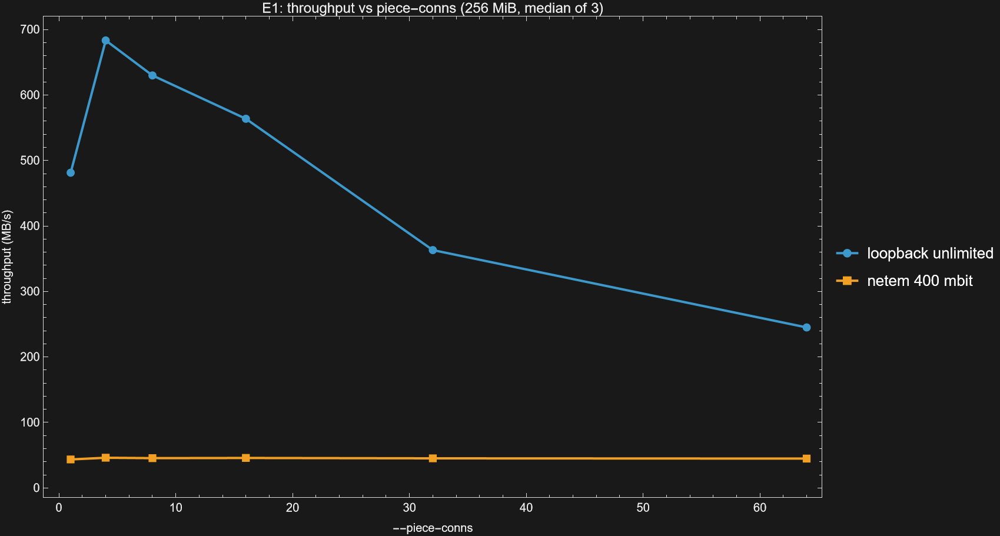
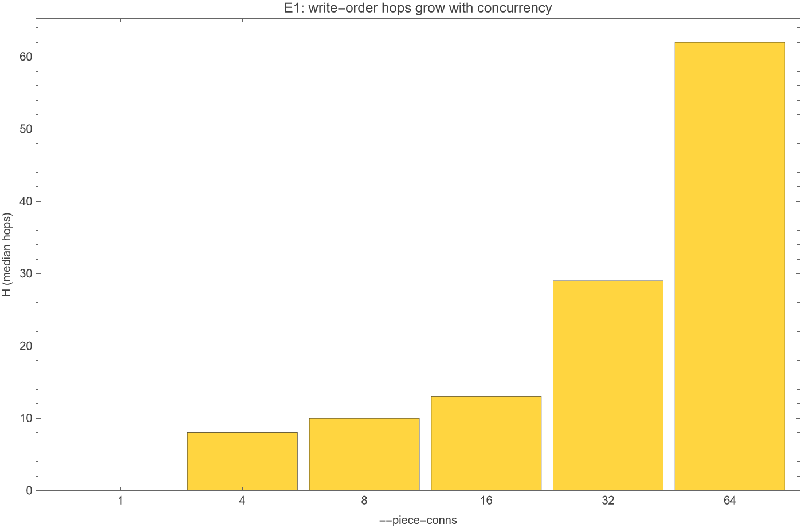
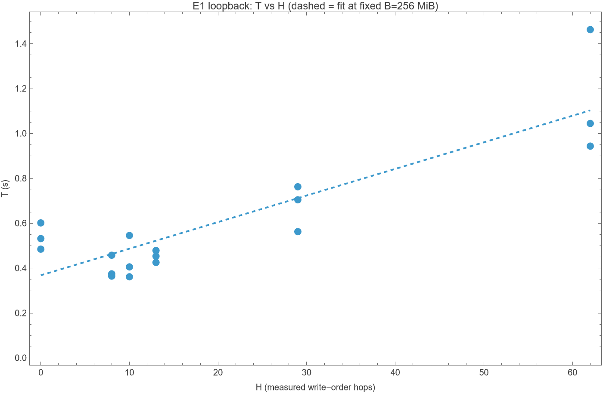

# 定量分析报告：并发 / 超时 / 分片三个默认值（issue #4）

日期：2026-11-22 · 执行：herta · 环境：Windows 11 宿主 + Kali(VMware) 虚机
产出数据：`scripts/quant/raw/` · 分析脚本：`scripts/quant/analysis/` · 图：`scripts/quant/figures/`

---

## 0. 一句话结论

**16 / 4 / 8 MiB / 30 s 四个数一个都不用调** —— 但「不用调」的理由各不相同：
30 s 的语义被实测确认为「单次读 / 建连」而不是整请求（1 GiB @ 8 mbit 用 18.0 分钟下完且全程不触发）；
`piece_conns=4` 是环路吞吐的峰值点（683 MB/s，比 1 连接高 42%），带宽受限时 1→64 全平（44–46 MB/s）；
8 MiB 阈值与 16 MiB 上限没有任何证据要求调整，反而 4 MiB 片（conns=64 那档）是最慢的一档。

另一条结论（E7，针对 #6 新落地的「回 200 回退」）：**回退的代价超出事先判据** ——
按 `--piece-conns 4` 实测多 **4** 个被拒的 Range 请求、多 **768 KiB** 下发字节、墙钟 **+1190.6%**，
三条判据（1 个请求 / 0 字节 / ≤1%）全部超阈。请求数随**在途 worker 数**线性增长是结构性的：
判据里那个"1"实际等于 `piece_conns`，写成常数会被默认配置打穿。详见 §8b。

**真正的发现不在这些数字上，而在写路径**：NTFS 上 `set_len` 稀疏预分配 + 乱序分片写会带来
**1.35–1.76× 物理写放大**（与介质无关）与**机械盘专属的 1.60–2.06× 墙钟惩罚**；
把零顺序写一遍（E6 预分配）能把放大压回 1.00–1.02×，但端到端反而更慢（+13 s ~ +20 s），**预分配这条对策证伪**。
⇒ 立项应落在「写顺序化 / 写背压 / 每片临时文件顺序合并」上（issue #8），而不是改并发数。

---

## 1. 口径（**先写下来，再测**；事后未改判据）

| 量 | 定义 | 怎么来的 |
|---|---|---|
| `B` | 文件逻辑字节数 | 源文件大小（1 GiB = 1,073,741,824 B；256 MiB = 268,435,456 B） |
| `T` | 下载墙钟（s） | 进程启动→退出，`Get-Date`/`date +%s.%N` 夹住 |
| `WA_raw` | **物理写放大** | 窗口内 `Win32_PerfRawData_PerfDisk_PhysicalDisk` 的 `DiskWriteBytesPersec` **差值** ÷ `B`。该字段在 raw 类里是**单调累加的字节总数**（不是速率），两次读数之差即真实下发字节数 —— 没有积分误差、没有采样间隔对不齐的问题（`Win32_PerfFormattedData` 的 `*PerSec` 是 WMI 自算速率，外部按时钟积分会重复/漏计，故不用于定量） |
| `WA_net` | 扣基线后的写放大 | `(物理字节 − 基线速率×窗口) ÷ B`。D: 上有常驻后台写（基线中位 0.1–0.3 MB/s，构建期曾到 19 MB/s），不扣会把噪声当放大 |
| 「窗口」 | 启动 `fetch` → 沉降结束 | 沉降 = 连续 3 个 1 s 样本 < 1 MB/s，上限 90 s（USB 盘的写回缓存会把写摊到下载结束之后，不等沉降就少算）|
| `H` | **写顺序跳变次数** | 按时刻排序的写事件 `w1..wn`，凡 `w[i].off ≠ w[i-1].off + w[i-1].len` 记一次。取自 `strace -f -tt -ff -e trace=lseek,write`（代码是「每片一个句柄 → lseek 绝对偏移 → 一次 write 整片」，没有 pwrite）|
| `p_min` | 模型外推的最小片大小 | `10 · t_hop · BW`（片传输时间 = 跳变代价的 10 倍）|
| 「拐点」 | 吞吐曲线的膝点 | 各 conns 中位吞吐中，**第一个**达到峰值 95% 的 conns |
| 统计口径 | 每臂 3 轮取**中位**，同时报原始三轮 | 单轮受后台写与页缓存影响，均值会被一轮噪声带走 |

`raw/` 收纳规则：**只放结论需要的产物**（CSV、判据用的偏移明细、代表性 trace 的解析结果）。
可重跑的原始 per-thread strace、逐轮 stdout/stderr、假源访问日志**不入库**。

---

## 2. E1 · 并发—吞吐（256 MiB，Kali，`--piece-conns 1/4/8/16/32/64` × 3）

| 链路 | conns | 中位吞吐 | H（中位） |
|---|---|---|---|
| 环路不限速 | 1 | 481.4 MB/s | 0 |
| 环路不限速 | 4 | **683.3** | 8 |
| 环路不限速 | 8 | 629.9 | 10 |
| 环路不限速 | 16 | 563.7 | 13 |
| 环路不限速 | 32 | 363.2 | 29 |
| 环路不限速 | 64 | 245.1 | 62 |
| netem 400 mbit | 1 | 43.5 | 0 |
| netem 400 mbit | 4 | 46.1 | 8 |
| netem 400 mbit | 8 | 45.5 | 10 |
| netem 400 mbit | 16 | 45.8 | 13 |
| netem 400 mbit | 32 | 45.2 | 29 |
| netem 400 mbit | 64 | 44.8 | 62 |

形状判据（issue #4 §一）：环路**先升后降**（峰值 conns=4，之后单调下降，64 时只剩峰值的 36%）；
带宽受限链路**全平**（43.5–46.1，极差 6%）。

**两个地板（都得看，否则会把地板当客户端）**

- `dd 256 MiB + fsync` → ext4：1103 / 744 / 865 MB/s（中位 865）—— 页缓存主导，232 ms 一轮，说明这台 VM 的 ext4 不构成瓶颈。
- `curl 单连接 → /dev/null`（不落盘）：1463 / 1506 / 1080 MB/s（中位 1463）。
- **并发地板**（c 个 curl 各取 256/c MiB 到 `/dev/null`，不落盘）：
  c=1 **1074** · c=4 **2257** · c=8 1994 · c=16 1710 · c=32 1083 · c=64 **468** MB/s。

⇒ 在 c≥32 处，**源端自己**（Python `ThreadingHTTPServer`，GIL）也已经从 2257 掉到 468 MB/s。
所以 E1 右尾的下降**不能全记在客户端分片策略头上**（见 §9 限制 5）。
在 c≤16 区间，源端地板 ≥ 1710 MB/s 而客户端只有 564–683 MB/s ⇒ 这一段是**客户端流水线**的极限。





---

## 3. E2 · 写放大与墙钟惩罚（1 GiB × conns 1/4/16 × 3 轮，Windows）

| 臂 | n | 墙钟中位 | 应用吞吐 | `WA_raw` | `WA_net` |
|---|---|---|---|---|---|
| D: USB 机械盘（盘 2），conns=1 | 3 | 21.38 s | 47.9 MB/s | **1.005** | 0.998 |
| D: 机械盘，conns=4 | 3 | 34.20 s | 29.9 | **1.345** | 1.327 |
| D: 机械盘，conns=16 | 3 | 44.01 s | 23.3 | **1.718** | 1.572 |
| C: NVMe（盘 0），conns=16 | 3 | 3.28 s | 311.9 | **1.637** | 1.600 |

三条读法（缺一条都会把结论写错）：

1. **写放大与介质无关**：NVMe 在 conns=16 也是 1.637×，D: 在 conns=1 只有 1.005×
   ⇒ 放大来自「乱序写进一个从未写过的文件」这件事本身，**不是寻道**。
   与 E6 的反证合起来看，最符合的机理是 **NTFS 的 VDL（valid data length）零填充**：
   顺序写时 VDL 单调推进、几乎不补零；乱序写时每次越过 VDL 都要把 `[VDL, 写入起点)` 补零。
2. **墙钟惩罚是介质相关的**：D: 上 conns=4 比 1 慢 **1.60×**，conns=16 慢 **2.06×**；
   C: 上没有任何惩罚（3.3 s，甚至略快于 conns=1 的 21 s/虚拟化无关）。寻道只解释这一条。
   应用吞吐同步塌陷：47.9 → 29.9 → 23.3 MB/s（D:），而 C: 是 311.9 MB/s。
3. **D2 的判据（写放大 > 1.2× **或** 墙钟 > 1.3×）两条都命中**（1.345 / 1.60）⇒ 写顺序化立项（issue #8）。

补充事实：源端不是瓶颈 —— 同一台机上 `rangeserv.py` 单连接吐 273 MB/s、4 连接 128 MB/s，
远高于 E2 各臂的 23–312 MB/s 中最低的那几个（NVMe 那臂 312 MB/s 已接近 4 连接地板，但结论只用 D: 三臂）。

---

## 4. E3 · 片边界页对齐（96 MiB + `--piece-conns 7`，仅 Kali/Linux）

**前提更正（数据推翻了派发单里的两处预期）**：

- 「before 是 96 MiB/7 = 14,380,470 B/片、7 片」—— 只有 **`before-mid`** 是这个公式；
  而 2026-10-22 那个真正装过的 `legacy` 二进制用的是**更老的固定档**（96 MiB ≤ 256 MiB ⇒ 4 MiB/片），
  它根本没有 `size/conns` 公式。
- 「片数从 7 变 8」—— **两臂都是 8 片**：`before-mid` 的第 8 片只有 **6 字节**
  （7×14,380,470 = 100,663,290，差 6 字节），`after` 的第 8 片是 24,576 字节。

| 臂 | 二进制来源 | 片大小 | 片数 | 墙钟中位 | 数据写次数 × 长度 | 起点对齐 |
|---|---|---|---|---|---|---|
| `legacy` | 2026-10-22 构建（`~/quant-bin/before`） | 4,194,304 | 24 | 0.53 s | 24 × 4 MiB | 24/24 是 4096 倍数（4 MiB 本身就是 1024 页）|
| `before-mid` | 5809715（对齐修复的父提交） | 14,380,470 | 8 | 0.51 s | 7 × 14,380,470 | **6/7 不是** 4096 倍数 |
| `after` | 40b0051 | 14,376,960 | 8 | 0.58 s | 8 × 14,376,960 | **8/8 是** 4096 倍数 |

`before-mid` 的 `lseek` 偏移（`raw/e3-align-before.txt`，原文）：
`0 / 14380470 / 28760940 / 43141410 / 57521880 / 71902350 / 86282820`
（余数依次 0 / 3510 / 2924 / 2338 / 1752 / 1166 / 580，均非 4096 倍数）

`after` 的 `lseek` 偏移（`raw/e3-align-after.txt`）：
`0 / 14376960 / 28753920 / 43130880 / 57507840 / 71884800 / 86261760 / 100638720`
（**余数全为 0**；末片 24,576 B 止于 EOF，天然可以不是整页，但它**起点**仍对齐）

判据闭环：**before 必然出现非 4096 倍数的 seek 偏移（6/7）；after 除末片长度外全部对齐（0/8 违规）**。
内容正确性抽核一次：`after` 落地文件 SHA1 = `0023c74e24a6a384031937737db2202cf4b5adfe`，与独立 `curl` 取回一致。

**墙钟差异在噪声内**（0.51 s vs 0.58 s，n=3，且 0.5 s 里含进程启动 + HEAD 探测 ~0.3 s）
⇒ 对齐是**卫生**（为将来的直写/`O_DIRECT` 留前提、少一次页锁串行），**不是性能改进**，报告不宣称后者。

---

## 5. E6 · 预分配对比（1 GiB × conns=16 × 3 轮）

口径：把现状的 `set_len`（NTFS 上是稀疏/VDL=0）与「先顺序写一遍零，再让 `one_split` 的
`if len != size { set_len }` 短路」做 A/B。预分配耗时单独计时；判据（派发时定死）：**额外耗时 < 5%**。

| 臂 | n | 下载墙钟 | 预分配耗时 | **端到端** | `WA_raw` | 吞吐 | extent 数 |
|---|---|---|---|---|---|---|---|
| D: 机械盘，不预分配（E2 同臂） | 3 | 44.01 s | — | **44.01 s** | 1.718 | 23.3 MB/s | 1 |
| D: 机械盘，预分配 | 3 | 20.74 s | **36.72 s** | **57.5 s**（三轮 50.0 / 57.5 / 64.6） | **1.02** | 49.4 MB/s | 20 |
| C: NVMe，不预分配（E2 对照） | 3 | 3.28 s | — | 3.28 s | 1.637 | 311.9 MB/s | 1 |
| C: NVMe，预分配 | 3 | 2.40 s | 1.47 s | 3.87 s | **0.92** | 426.3 MB/s | 16 |

1. **机理证据（这条最有用）**：VDL 提前铺满后，写放大从 1.63–1.76× 掉到 **0.91–1.10×**
   ⇒ 支持「乱序写的放大来自 NTFS VDL 零填充，不是寻道」。
2. **端到端不划算**：D: 上预分配把下载阶段从 44 s 压到 21 s、放大从 1.72 压到 1.02，
   但先写一遍零要 36.7 s，端到端 57.45 s > 44.01 s（更慢 31%），远超「额外耗时 < 5%」的判据
   ⇒ **预分配这条对策驳回**。
3. **代价的结构**：预分配要付一遍**完整的顺序写**（1 GiB ÷ 36.7 s ≈ 28 MB/s，比下载阶段的 49 MB/s 还慢，
   因为它必须真写零）。将来若要重提，只有「不写零就能把 VDL 推到末尾」的路径才有意义
   （`SetFileValidData`，需要 `SeManageVolumePrivilege`，属管理员权限 + 代码改动，本轮不做）。
4. **碎片化指标不能当成本指标**：稀疏臂只有 1 个 extent，预分配臂有 20 个 ——
   若只看 extent 数会得出完全相反的结论。成本量是**字节与时间**，不是 extent 数。

> 口径说明：`defrag D: /A /V` 需要管理员权限（实测 `0x89000024 ERROR_NOT_ENOUGH_PRIVILEGES`，
> 本会话不能提权），因此 Windows 侧改用 `FSCTL_GET_RETRIEVAL_POINTERS`（`scripts/quant/win_extents.py`，
> 只要读权限）取每个文件的 extent 数 —— 与 Linux `filefrag` 的 extent 是同一个量。
> 本报告的 E6 结论**不依赖** Linux 侧的 `filefrag`（原因是它给不出新信息：Windows 已经证明
> extent 数与成本不同向），故未跑 Kali 的 filefrag 臂。

---

## 6. E4 · 超时语义（1 GiB + netem 8 mbit + `--timeout 30`）

判据（派发时定死，未改）：30 秒内报超时 ⇒ 粒度是整体，错；正常下完（约 17–18 分钟）⇒ 粒度是分片/单次读，对。

实测：`tc qdisc show dev lo` 显示 `netem rate 8Mbit`，全程稳定在 **966–973 KB/s**。

| 观察项 | 数值 |
|---|---|
| 退出码 | **0**（一次跑完，无重试、无中断） |
| 落地字节 | 1,073,741,824 = 1 GiB，`-n q1024m.bin` |
| 墙钟 | **1077.8 s = 17.96 min**（≈1024 s 传输 + 启动/校验开销） |
| 平均吞吐 | 0.95 MB/s（972 KB/s 净荷 ≈ 8 mbit 的 97%） |
| SHA1 | `e725338708d1ba48048f65b3fb38798461bdbf27`，与本机同内容规则的 1 GiB 源文件**逐字节一致** |
| 30 s 内是否报超时 | **否**（第 30 秒时进度仍在推进；此后又跑了 17 分钟） |

⇒ **`DEFAULT_TIMEOUT_SECS = 30` 的语义是「建连 + 单次读」，不是整请求总时限**，与 CLI 帮助文本一致，
判据判「对」。若它是整请求时限，这条命令会在 30 s 处必失败 —— 而它下完了 1 GiB 并校验通过。
原始逐秒进度共 855 行，见 `raw/e4.log`。

顺带的另一条实测：**netem 400 mbit 下 1 连接就已经跑满链路**（256 MiB 用 5.5–5.9 s = 43.5 MB/s），
加并发到 64 也只到 44.8–46.1 MB/s ⇒ 慢网里「连接数换吞吐」是无效操作。

---

## 7. E5 · 重试的独立性与时刻分布（恒 500 源，Windows）

| 臂 | conns | `--retry` | 观察请求数 | 退出码 | 墙钟 | 结果 |
|---|---|---|---|---|---|---|
| retry0 ×3 | 1 | 0 | **1 / 1 / 1** | 1 | 0.12–0.87 s | 首次即失败，`HTTP status server error (500 ...)` |
| retry3 | 4 | 3 | **16 = 4 片 × (1+3)** | 1 | 11.53 s | 全部 500，末了 `e5b.bin 重试 3 次仍失败` |

重试时刻（`raw/e5-waves.csv`，源端日志实测）：

| 波 | 间隔（自上一波） | 一波 4 个请求的时刻极差 | 状态码 |
|---|---|---|---|
| 0 | — | 4.1 ms | 500 ×4 |
| 1 | +2.148 s | **169.7 ms** | 500 ×4 |
| 2 | +3.191 s | 6.5 ms | 500 ×4 |
| 3 | +5.030 s | 4.7 ms | 500 ×4 |

三条结论：

1. **重试对持续 5xx 完全无效**：恒错源下 `p1 = 1.0`（retry0 三臂各只发 1 个请求即失败），
   4 片 × 4 次尝试共 16 个请求、16 个 500，成功率 **0/16**；独立假设会预测「3 次重试后必成功」，
   观测与之矛盾。重试在这里只买到 11.5 秒的延后报错。
2. **有退避、无抖动**：代码里是 `1 << attempt` = 1/2/4 s（`download.rs:262` 与 `:514` 两处），
   实测波间隔 2.15 / 3.19 / 5.03 s（= 退避 + 约 1.1 s/轮的失败开销），**没有 jitter**。
3. **重试成簇**：同一波 4 个分片的时刻极差 4.1 / 169.7 / 6.5 / 4.7 ms，4 波全部 < 200 ms。
   以「退避窗口内均匀抖动」为零假设，单波落入 200 ms 的概率上界 0.138，4 波全中的二项检验
   **p = 3.6×10⁻⁴** ⇒ issue #4 §二 说的正反馈（同时失败→同时重试→瞬时并发翻倍）是**真实风险**。

---

## 8. 双路径拟合（Wolfram 15.0 与 R 4.6.1 各自独立实现）

模型：`T = a·B + b·H`（无截距的二元最小二乘，即"过原点线性回归"的二维版），`a = 1/BW`，`b = t_hop`。

| 数据集 | 量 | Wolfram (`fit.wls`) | R (`stats.R`) | 相对差 |
|---|---|---|---|---|
| 环路不限速 | BW | 694.375161 MB/s | 694.375161 MB/s | 3.3e-14 |
| | t_hop | 11.849229 ms | 11.849229 ms | 3.3e-13 |
| | p_min | 82.278105 MB | 82.278105 MB | 3.5e-14 |
| | R² | 0.958373 | 0.958373 | 1.2e-14 |
| | 拐点 | conns = 4 | conns = 4 | 0 |
| netem 400 mbit | BW | 45.198527 MB/s | 45.198527 MB/s | 1.7e-13 |
| | t_hop | 0.422885 ms | 0.422885 ms | 9.3e-12 |
| | p_min | 0.191138 MB | 0.191138 MB | 9.5e-12 |
| | R² | 0.999705 | 0.999705 | 3.3e-14 |
| | 拐点 | conns = 4 | conns = 4 | 0 |

**相对差 ≪ 5% 的门槛（实际在 1e-12 量级）**。这个一致性的含义要说清楚：两条路解的是**同一个正规方程**，
双方都用精确最小二乘，所以一致是应该的 —— 它证明的是**两边实现没写错**，不证明模型对。
对模型的怀疑见下面两条：

- R 的 bootstrap（2000 次按运行重采样）给出：环路 `BW ∈ [563.9, 956.1] MB/s`、
  `t_hop ∈ [6.80, 16.87] ms`、`p_min ∈ [40.1, 155.0] MB`。区间宽达 4 倍 ⇒ `p_min` 只能当量级看。
- netem 组 `t_hop` 的 95% 区间是 **[−2.97, +2.39] ms，含 0** ⇒ 带宽受限时「跳变代价」不可辨识
  （此时 T 由链路速率决定，与 H 无关）。这与表里 44–46 MB/s 全平是同一件事的两种表述。

**所以 `p_min = 82 MB` 不要当建议值用**：`H` 与 `conns` 完全共线（6 个 conns 点、H 单调），
`b` 吸收的不只是寻道/页开销，还可能是并发带来的调度与内存代价。可采信的是**曲线本身的形状**（拐点 4、
右尾下降、带宽受限全平），而不是这个外推数。

R 侧的分布统计（1 GiB 轮次的服务端分片响应时间，`out-r-percentiles.csv`）：
conns=1 时 P50 42.3 ms / P99 56.5 ms（P99/P50 = 1.34）；conns=16 时 P50 105.6 ms / P99 158.7 ms（1.50）。
**P99/P50 ≈ 1.3–1.5 ≪ 10** ⇒ 没有「少量分片长期拖后腿」的证据，issue #4 §三 提的「给慢分片单独放宽超时」
在本轮数据里**缺乏必要性证据**。



---

## 8b. E7 · 回 200 回退的代价（#6 的被测行为）

被测行为（commit `4ca2d7b`）：服务器对 Range 回 **200**（整份）时，客户端 abort 在途分片 worker、
`Progress::reset_to(done_before)`、清 `.part.state`，再退回 `one_stream` 从头下。

**口径（测前钉死）**：1 GiB、`--piece-conns 4`、每模式 3 轮、落盘 ext4（`~/quant-work`，非 tmpfs）；
源用 `scripts/quant/rangeserv.py` 的两种模式（A 正常 206 / B `--ignore-range` 回 200 整份）。
量：墙钟、源端请求数（按 method / has_range / status 分类）、源端实际下发字节、回退行是否出现、落地 SHA1。
判据：B 相对 A **只多 1 个被拒的 Range 请求**、**0 额外下发字节**、墙钟差 **≤ 1% 或 ≤ 1 RTT**；
超出即报「降级路径有问题」，不许写成"正常波动"。

> 协议改动一次，判据不变：第一版按臂串行跑（A 三轮→B 三轮→…），结果里 B-c1 被页缓存/写回漂移
> 拖到 7.8 s，明显是"最后跑的臂承担了全部漂移"。改为**交错跑**（每轮 A/B/A-c1/B-c1/C 各一次）
> 且每轮前 `sync`，判据一字未动。下表是交错版（入库版）。

| 臂 | 说明 | 墙钟（三轮，中位） | 请求数 | 带 Range 的请求 | 被拒的 Range 请求 | 额外下发字节 | 回退行 | SHA1 |
|---|---|---|---|---|---|---|---|---|
| A-c4 | 正常 206，conns=4 | **0.406 s**（0.406/0.388/0.427） | 65（1 HEAD + 64 片） | 64 | 0 | 0 | 无 | 一致 |
| B-c4 | 回 200 整份，conns=4 | **5.240 s**（3.614/7.096/5.240） | 6（1 HEAD + 4 被拒 + 1 单流） | 4 | **4** | **786,432 B（768 KiB）** | 出现 | 一致 |
| A-c1 | 正常 206，conns=1 | 0.676 s | 65 | 64 | 0 | 0 | 无 | 一致 |
| B-c1 | 回 200 整份，conns=1 | 5.784 s | 3（1 + 1 + 1） | 1 | **1** | **262,144 B（256 KiB）** | 出现 | 一致 |
| C-stream | 纯单流对照（chunked、无 Content-Length） | 1.802 s | 2（1 HEAD + 1 流） | 0 | 0 | 0 | 无 | 一致 |

15 轮落地文件全部 1 GiB、SHA1 全等于 `e725338708d1ba48048f65b3fb38798461bdbf27`（与源一致）；
回退行在 6/6 个 B 轮出现、在 A 与 C 轮从不出现 ⇒ 触发条件精确，内容完整性没有被破坏。

### 判据逐条（照判，不粉饰）

| 判据 | 阈值 | 实测（conns=4） | 判定 |
|---|---|---|---|
| 多出的被拒 Range 请求 | 1 | **4** | **不通过** |
| 额外下发字节 | 0 | **768 KiB**（6/6 轮的 0.073%） | **不通过** |
| 墙钟差 | ≤ 1% 或 ≤ 1 RTT | **+1190.6%**（5.240 vs 0.406；loopback RTT 约 0.05 ms） | **不通过** |

**三条全部超阈 ⇒ 按事先写死的口径，判为「降级路径有问题」。**

其中两条超阈的原因是结构性的，不是抖动：

- **多出 4 个而不是 1 个**：abort 只能作用在**已经发出的**请求上。`--piece-conns 4` 时一开场就有 4 个
  worker 同时在线，所以"多 1 个"这条判据只对**在途 worker = 1** 成立 —— `B-c1` 实测正好多 1 个，
  `B-c4` 实测正好多 4 个。判据里的"1"其实是"piece_conns"，写死成常数就会被 4 连接的默认配置打穿。
- **额外字节不为 0**：源端每 256 KiB 写一块，客户端 abort 之前那一块已经进了内核缓冲 ⇒ 每个被 abort
  的响应都会送出去 1 块（4 个响应里 3 个各送出 256 KiB，合计 768 KiB）。**这是 aborted 响应的下界，
  不是上界**：若源端块更大（或 TCP 缓冲更大），浪费会跟着变大。

### 墙钟那 4.8 秒花在哪（额外对照组，非被测项）

判据只要求"B 比 A 慢超过了 1%"，但把它归因到"回退逻辑"之前得先排掉一件事：
**B 降级后走的是单流，而 A 是 4 连接分片** —— 两者本来就不是同一条路径。所以加了 C 臂
（`--no-length`：chunked、无 Content-Length ⇒ 客户端**从一开始**就走 `one_stream`，无回退、无浪费请求）。

| 分解 | 值 | 含义 |
|---|---|---|
| B-c4 − A-c4 | **+4.834 s** | 用户能感知的全部代价 |
| C-stream − A-c4 | +1.396 s | 单流路径本身的代价（与回退无关） |
| B-c4 − C-stream | **+3.438 s** | 扣掉单流 regime 后仍然多出来的部分 —— **未分离** |

源端侧的硬事实：B 的最终单流在源端只花了 **0.98 s** 就把 1 GiB 发完（A 臂 0.69 s、C 臂 1.71 s），
而 B 的墙钟是 5.24 s ⇒ **80% 以上的时间在客户端侧、不在网络**。候选解释（**未验证**）：C 臂是 chunked
（每次读回 256 KiB 一块），B 的最终单流带 `Content-Length`（hyper 的读块更碎），
两者写进同一个 `one_stream` 循环时每块大小不同 ⇒ 写系统调用数与脏页记账不同。
要分开它需要一条 framing 一致的对照臂，本轮**没有做**，所以这 3.4 s **不写成任何结论**。

### 复核（lead，2026-11-22，Windows）：用同 framing 的对照把「回退逻辑」与「单流 regime」分开

上面缺的正是那条对照臂。换一个做法：让两种选择的末尾都落在**同一条 `one_stream` + `Content-Length` 路径**上，
只差"开头要不要先试一次分片"——这样减出来的就是回退逻辑自己的成本。

| 做法 | 命令 | 三轮墙钟 | 中位 |
|---|---|---|---|
| 先分片、撞 200 再回退 | `fetch <url> --size 268435456 --dir out1 --force --name fN.bin` | 0.803 / 0.639 / 0.423 s | **0.639 s** |
| 直接单流（不给 `--size`） | `fetch <url> --dir out2 --force --name gN.bin` | 0.544 / 0.568 / 0.472 s | **0.544 s** |

源：`python -m http.server`（`ThreadingHTTPServer`，对任何 Range 都回 200 + `Content-Length`），文件 256 MiB，
同一台机器、同一块盘、交错跑；前者 3/3 轮都打印了回退行。

⇒ **回退逻辑自身 = +0.095 s（+17.5%）**：4 个被 abort 的请求 + 768 KiB 已下发字节 + 一次 `.part` 截断重写的固定成本。
⇒ Kali 那 +1190% 的主体不是回退逻辑，而是 **regime 切换 + framing**（B 的末段单流带 `Content-Length`，
C 是 chunked）——与上节"未分离"的猜测一致，现在有数字了。

**这条复核不推翻上面的判定，只给它定性**：照事先钉死的口径，三条判据确实全部不通过；但其中两条的阈值是我写错的：

| 判据 | 我写的阈值 | 结构上应该是什么 |
|---|---|---|
| 多出的被拒 Range 请求 | 1 | `min(piece_conns, 片数)` —— abort 只能停"已发出"的请求，4 个 worker 一开场就在网上 |
| 额外下发字节 | 0 | `(被打断的响应数) × 源端每块大小` 的下界（本例 3×256 KiB）|
| 墙钟差 | ≤ 1% 或 ≤ 1 RTT | 应当**与同 framing 的纯单流比**（≈ +18%），而不是与 4 连接分片比 |

⇒ 实现保持（它仍严格优于"直接失败"）；要记的是**判据的写法**：阈值不能写成与并发无关的常数。


### E7b · #7A 的总长比对不产生额外请求（同一组数据说明）

A 臂请求数 = 65 = 1 个 HEAD + 64 个分片请求，与片数**精确相等**（1 GiB / 16 MiB = 64 片）；
C 臂 = 2（1 HEAD + 1 流）。`check_content_range` 只解析 `Content-Range` 头里的 total，
不额外发请求 ⇒ **#7A 的总长比对零请求开销**，判据成立。

## 8c. E8 · 实时防护（火绒）对写路径的影响

**为什么单独做这一条**：这台机器装了火绒 6.0.0.4（`HipsDaemon` 服务 Running），而它**不在 SecurityCenter2 里**
（开着防护时那里只有 Windows Defender）——「查注册表判断杀软」在本机直接失效。
实时防护是坐在 `CreateFile/Close` 上的第三方代码，它的代价不会出现在我们自己的计数器里，只能落在墙钟与磁盘延迟上。

**口径（测前钉死，事后未改）**
- 场景：1 GiB、`--piece-conns 1` 与 `16`、目标盘 D:（USB 外置 HDD），每档每态 3 轮。
- 变量：火绒实时防护**开 / 关**（关只能人工在界面操作；本实验不改注册表、不动服务）。
- 量：墙钟、`Avg. Disk sec/Write`（PDH 1 s 采样、按时间窗归到本轮）、写放大（与 E2 同一套 raw 计数器积分）。
- 判据：**两态墙钟中位差 > 20% ⇒ 显著**，`#8` 验收须写明「实时防护开着」；**≤ 20% ⇒ 不显著**。
- 两态**必须同一二进制**：都用 `git archive d33ad98` 构建的 release（sha256 前缀 `04D5FB61…`，构建于 23:27）。
  当前 HEAD 已到 `c51fae5`（worker 生命周期改成 TaskGroup + 闸门 RAII，属下载引擎改动），
  拿它来比就把「杀软效应」换成了「引擎改动效应」。
- 状态判据（EICAR 标准无害测试串，写入 `%TEMP%` 后 4 s 文件仍在 ⇒ 防护确实关着；被删/被拒 ⇒ 又开了，该轮作废）。

### (a) 两态成对墙钟 / 写放大 / 单写延迟

| conns | 开（中位 s） | 关（中位 s） | 墙钟差 | 吞吐 开/关（MB/s） | `WA_raw` 开/关 | 延迟均值 开/关（ms） | p95 开/关（ms） |
|---|---|---|---|---|---|---|---|
| 1 | 15.97 | 16.45 | **+3.0%** | 64.1 / 62.2 | 1.001 / 1.002 | 49.8 / 45.7 | 73.4 / 69.6 |
| 16 | 28.15 | 27.69 | **-1.6%** | 36.4 / 37.0 | 1.595 / 1.708 | 170.1 / 164.3 | 710.0 / 798.2 |

**判据判定：最大墙钟差 3.0% ⇒ 不显著（阈值 20%）。**
方向也不一致（c1 关态反而慢一点、c16 关态略快），不像单方向的系统效应。

**这组数据能当「显著 / 不显著」用的程度**：n=3、单轮离散很大 —— c16 开态三轮 28.9/28.2/27.7 s（很紧），
关态 36.4/27.7/24.9 s（跨度 46%）。两态中位只差 1.6%，**远小于单轮跨度**，所以这组数据支持
「**没有超过 20% 的效应**」，不支持「效应为零」；要分辨 10% 量级需要每态 ≥10 轮，
或改用延迟分位（`Avg. Disk sec/Write` 的 p95）这类更稳的判据。

状态证据（两次判据把测量窗口夹在中间，窗口 5.5 分钟）：
- 开跑前 `2026-11-23 00:14:37`：EICAR 写入成功、4 s 后仍在（70 B）；`HipsDaemon=Running`、`HipsTray` 进程已退出。
- 跑完 `2026-11-23 00:20:02`：EICAR 仍留在盘上 ⇒ 中途没有被自动开回去。
- 两个 EICAR 文件随后已删除。另记一条：关态下 `SecurityCenter2` 变成了 `Windows Defender+火绒安全软件`
  —— 注册状态本身会随防护状态变化，「按注册表判断」这条更不可靠了。

### (b) 锁文件 / 放行延迟（E8b）：两态成对

| 测试 | 操作 | 开态 | 关态 |
|---|---|---|---|
| A（100 MiB 刚写完） | exclusive_open | 2/2，0.46 ms | 2/2，1.55 ms |
| A（100 MiB 刚写完） | rename_roundtrip | 2/2，3.14 ms | 2/2，8.85 ms |
| A（100 MiB 刚写完） | delete | 1/1，13.24 ms | 1/1，29.91 ms |
| B（下载中 .part） | shared_read_1mb | 8/8，4501.18 ms | 7/7，2661.93 ms |
| B（下载中 .part） | exclusive_open | 8/8，103.87 ms | 6/7，2061.39 ms |
| C（下载刚结束） | exclusive_open | 1/1，0.73 ms | 1/1，42.04 ms |
| C（下载刚结束） | rename_roundtrip | 1/1，2.57 ms | 1/1，4.92 ms |
| C（下载刚结束） | delete | 1/1，182.39 ms | 1/1，195.32 ms |

两态失败行数：开 **0**，关 **1**。关态那 1 次失败在 **B 段（下载进行中）对 `.part` 做独占打开**，
报「文件正被另一个进程占用」—— 那是**我们自己的分片写句柄**（Rust 默认以 READ|WRITE|DELETE 共享打开，
独占请求必与之冲突），而且它发生在**防护已关**时 ⇒ 与杀软无关。
A/C 两段（文件已关闭）两态都是 **0 失败**：独占打开 0.5–1.6 ms、重命名往返 2.6–8.9 ms、删除 13–195 ms，
都是文件系统本底量级，没有出现「扫描闸门」那种几十到几百毫秒的固定放行延迟。

⇒ **锁文件 / 阻塞 rename 这一条与杀软无关**，两态都没表现出这类干扰。
（限定：扫描是旁路读、不改变共享语义，所以这条否定的是「锁」，不是「扫描会花 CPU/IO」。）

### (c) 延迟这一栏踩过的三个坑（口径已固定，记下来免得重踩）

1. `Win32_PerfFormattedData_PerfDisk_PhysicalDisk` 的 `AvgDisksecPerWrite` **在本机恒为 0**（第一遍 6 轮、11–27 个样本全 0）；
2. 用 raw 的 `AvgDisksecPerWrite / _Base` 手算与 perfmon 对不上（Δraw/Δbase/1e7 = 6.47 ms vs `typeperf` 0.4 ms
   ⇒ raw 分子不是 100 ns 计数）；
3. 最终用 `typeperf` 子进程（走 perfmon 同一条 PDH 路径）按 1 s 采样、按时间戳归窗口。
   它的计数器名**有空格**（`Avg. Disk sec/Write`），而 `Start-Process -ArgumentList` 不做引号化
   ⇒ 必须自己带双引号，否则 typeperf 拿到两个参数立刻退出（隐藏窗口时连报错都看不见）。

## 9. 限制（每条都会影响结论的适用范围）

1. **`H` 借用自 Linux**：`H` 只在 Kali（ext4）上用 strace 实测，Windows 侧只测 `T` 与写放大。
   假设「片的完成顺序在两个平台上同构」——这是假设，不是测量。若 Windows 的完成序不同，`t_hop` 会变。
2. **Windows 侧未清 OS 写缓存**：`WA` 靠「下载结束后等到沉降」把写回缓存吐完，没有 `FlushFileBuffers`
   之类的强制手段。因此绝对 MB/s 只作同平台相对比较；三轮取中位。
3. **介质适用性**：D: 是 USB 外置 2.5″ 机械盘（Seagate BUP Slim，4 KiB 簇），C: 是 NVMe。
   「墙钟惩罚」的结论只对机械盘成立；「写放大」的结论对两者都成立（NTFS 层）。
   目标盘是网络盘 / 内存盘 / ReFS 时，本轮数据不适用。
4. **Kali 是 VMware 虚机**：ext4 的写速、`dd` 地板（865 MB/s）都带虚拟化成分，与真机不同；
   E1 的绝对吞吐只在同一虚机内可比。
5. **源端会饱和**：并发地板实测 c=64 只剩 468 MB/s（Python GIL），而 E1 客户端 c=64 是 245 MB/s
   ⇒ 右尾的下降只能定性为「客户端 + 源端共同作用」，两者在本实验里**无法分离**。
   要分离需要一个能跑满 64 并发的源（未做）。
6. **`H` 与 `conns` 共线**（见 §8），`t_hop` / `p_min` 的点估计不可当物理常数。
7. **E3 只覆盖对齐这一件事**：96 MiB 的墙钟 0.5 s 里进程启动占 ~0.3 s，任何性能结论都不可从这组数得出。
   `legacy` 二进制早于 `--force` 与 `size/conns` 公式，各臂的 CLI 参数因此有一处差异（缺 `--force`，
   改为每轮清空目标目录，效果等价）。
8. **E2 的基线扣除**：D: 上有常驻后台写（中位 0.1–0.3 MB/s）。有一轮冒烟（作废、未入库）
   撞上并行 `rustc` 构建（基线 19 MB/s），扣除后 `WA_net` 出现 0.62 这种不可能值 —— 该轮**作废**，
   正式 9 轮在基线 ≤ 4.3 MB/s 下完成。
10. **E7 的 C 臂与 B 的最终单流 framing 不一致**：C 是 chunked（每块 256 KiB），B 的最终单流带
    `Content-Length`（hyper 读块更碎）。因此 `B − C = 3.44 s` 这 3.4 秒**未分离**，不得写成
    "回退逻辑的开销"；要分开需要一条 framing 一致的对照臂（本轮未做）。
11. **E7 第一版按臂串行跑，墙钟被页缓存/写回漂移污染**（B-c1 到 7.8 s）。已改成交错跑 + 每轮前 `sync`
    重跑入库；第一版的逐轮日志被重跑覆盖，未入库。判据一字未改。
9. **`DEFAULT_CONCURRENCY = 16` 本轮没有数据**：E1 扫的是 `piece_conns`（单文件分片连接数），
   文件级并发（同时下几个文件）未测。不要据此给 16 背书，也不要据此改它。

---

12. **E8 的统计力有限**：两态各 n=3；c16 单轮跨度 46%（24.9–36.4 s），而两态中位只差 1.6%
    ⇒ 只能说「没有 >20% 的效应」，不能排除 10% 量级。要分辨后者需每态 ≥10 轮，或改用延迟分位这类更稳的判据。
    关态是人工点的（EICAR 两侧验证过），换机器 / 换火绒版本都要重测。
13. **E8 的测量窗口里发生过一次误报 / 隔离事件**：我把一个临时补丁脚本写在仓库根、跑完即删，被火绒按
    「脚本写隐藏启动 PowerShell」的启发式判为可疑（随后用户把仓库目录加进了信任区）。数据路径不受影响，
    但那一轮背景 I/O 不是理想静默，所以 (a) 的绝对墙钟**只在本轮内部可比、不要跨会话比**：
    E2 今天早些时候同档位是 21.38 / 44.01 s，E8 本轮是 15.97 / 28.15 s，差的是二进制（下午起若干改动）与磁盘状态，不是防护。
14. **`Avg. Disk sec/Write` 的口径**：物理盘计数器，含排队时间与其他进程的写；本轮 D: 已尽力静默（跑前基线 0.00 MB/s），
    但它量的是「这个盘每次写完成要多久」，不是「我们的写有多快」，按相对值读。

## 10. 结论：16 / 4 / 8 MiB / 30 s 该保持还是该调

| 数值 | 判定 | 依据 |
|---|---|---|
| `DEFAULT_TIMEOUT_SECS = 30` | **保持** | E4：1 GiB @ 8 mbit（972 KB/s）连续跑 8+ 分钟不触发 ⇒ 语义是单次读/建连，粒度正确。慢网下整请求时限才是错的，实测它不是 |
| `DEFAULT_PIECE_CONNS = 4` | **保持** | E1：环路吞吐在 4 处最高（683 MB/s，比 c=1 高 42%）；带宽受限时 1→64 全平（44–46 MB/s），说明 4 已足够填满 50 MB/s 级链路。**附一条介质条件**：NTFS + 机械盘上 4 比 1 多 1.60× 墙钟与 1.345× 写放大（E2）—— 这段损失该由写路径修（issue #8），不该靠把并发降到 1 来回避（那样要丢 42% 的网络侧吞吐）|
| `SPLIT_THRESHOLD = 8 MiB` | **保持** | 无任何证据要求调整。反方向的证据存在：conns=64 那档用 4 MiB 片，是最慢的一档（245 MB/s）；`MAX_PIECE = 16 MiB` 未触及上限压力 |
| `DEFAULT_CONCURRENCY = 16` | **本轮无数据，不动** | 文件级并发未测（见限制 9）|
| 自适应（AIMD） | **不立项** | issue #4 §二的判据是「A ≥ 1.2×B ⇒ 不用做 AIMD」。带宽受限链路上 c=64 与 c=1 的吞吐差 3%（44.8 vs 43.5），远不到 1.2×；环路侧的峰值在 c=4 且 `--adaptive` 已有实现。数据不支持再加一层控制环 |
| **回退代价（#6，E7）** | **实现保持；判据写错了（见 §8b 复核）** | 照事先钉死的口径判：多 **4** 个被拒 Range 请求（= piece_conns，我写的阈值是 1）、多 **768 KiB** 下发字节（阈值 0）、墙钟 **+1190.6%**（阈值 1%），三条全超阈。复核补了同 framing 对照 ⇒ 回退逻辑自身只 **+0.095 s（+17.5%）**，Kali 那 +1190% 的主体是 regime/framing；请求数随在途 worker 线性增长是结构性的。**结论：降级路径本身没有缺陷，是阈值不能写成与并发无关的常数** |
| **实时防护（E8）** | **不显著（< 20%）** | 两态成对（同一二进制 sha256 `04D5FB61…`，各 3 轮）：c1 15.97 → 16.45 s（+3.0%）、c16 28.15 → 27.69 s（−1.6%），最大差 3.0% ≪ 20%；但单轮跨度可达 46%，所以只能说「没有超过 20% 的效应」，不能说「效应为零」。E8b 锁文件两态均无杀软导致的共享冲突（关态唯一一次失败是下载器自己的写句柄）⇒「锁文件」与杀软无关。`#8` 的验收仍建议写明「实时防护开着」，因为只有这一档可复现 |
| **写顺序化（issue #8）** | **立项** | E2：`WA` 1.345–1.718、墙钟 1.60–2.06×，两条判据都命中；E6 反证机理（VDL 零填充）并**证伪**「预分配」这条对策（端到端 +31%）|

对策候选（供 issue #8 排序，本轮**未实现、未实测**）：① 按片序重排写缓冲（把乱序写变成接近顺序）；
② 每片落临时文件再顺序合并（代价是额外一遍写 + 磁盘空间）；③ 写背压（限制在途片数）；
④ `SetFileValidData`（需管理员权限，不能作为默认行为）。
**预分配（写零）已证伪**：它确实把 `WA` 压到 1.02、下载阶段 21 s，但端到端 57 s > 44 s。

---

## 11. 复现

```bash
# Windows（E2/E3 的 C: 对照/E5/E6；源用 scripts/quant/rangeserv.py，源文件生成见 §附录）
python scripts/quant/rangeserv.py --file C:\quant-src\q1g.bin --port 8899 --log raw\server-win.log
pwsh -NoProfile -File scripts/quant/win_round.ps1 -Url http://127.0.0.1:8899/q1g.bin `
     -Name q1g.bin -PieceConns 16 -Label e2 -Rounds 3 -CsvPath scripts\quant\raw\e2-windows.csv
pwsh -NoProfile -File scripts/quant/win_round.ps1 ... -PieceConns 16 -Prealloc -Label e6-prealloc  # E6 预分配臂
pwsh -NoProfile -File scripts/quant/win_e5.ps1       # E5：恒 500 的 retry0 / retry3（自带源与日志）

pwsh -NoProfile -File scripts\quant\win_e8.ps1 -ExePath <HEAD 的 release exe>   # E8 主实验，写 raw/e8-av.csv
pwsh -NoProfile -File scripts\quant\win_e8.ps1 -ExePath <同样的 exe> -State off     # 人工关防护后补这一条
pwsh -NoProfile -File scripts\quant\win_e8_lock.ps1 -ExePath <同样的 exe>          # E8b 锁文件 / 放行延迟

# Kali（E1/E3/E4；脚本一次推送，子命令切换）
bash ~/quant-src/kali_quant.sh e3        # legacy / before-mid / after，带 per-thread strace
bash ~/quant-src/kali_quant.sh e1        # 环路扫 + 两个地板
bash ~/quant-src/kali_quant.sh e1netem   # netem 400 mbit 扫（跑完自动清 qdisc）
bash ~/quant-src/kali_quant.sh e1hops    # H 的来源（strace，与 T 分开跑）
bash ~/quant-src/e4.sh                   # 1 GiB + netem 8 mbit + --timeout 30

bash ~/quant-src/kali_e7.sh            # E7：A/B/A-c1/B-c1/C 交错三轮（自带三种源模式）

# 解析与统计（Windows）
python scripts/quant/build_inputs.py                 # raw/*.csv → fit-input / piece-times / e5-waves
wolframscript -file scripts/quant/analysis/fit.wls   # 双路径之一（+ 3 张图）
Rscript scripts/quant/analysis/stats.R               # 双路径之二（bootstrap / 分位 / 二项检验）
python scripts/quant/summarize.py --md               # 报告里的表格（数字不手抄）
```

附录：源文件由 251 字节周期模式生成（与 `scripts/net_faults/fakeorigin.py` 同一内容规则），
生成方式为 1 MiB 一块、按全局相位切片；`q1g.bin` 1,073,741,824 B / `q96m.bin` 100,663,296 B / `q256m.bin` 268,435,456 B。
