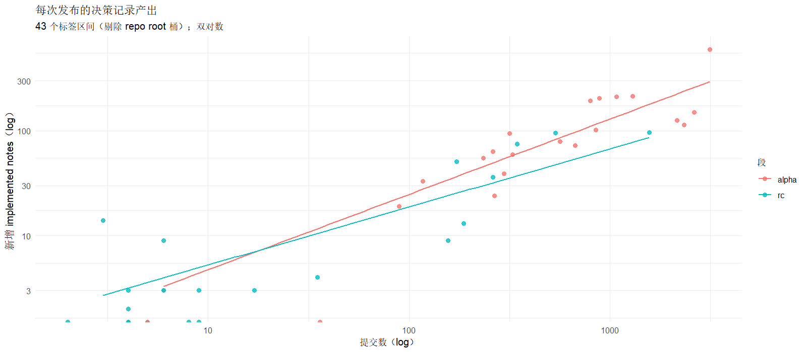

# 定量研究：版本号与决策记录的生命周期（对照 deepseek-harness）

**问题**：我们准备把「版本号由决策记录（`.agents/notes`）推导」写进规矩 —— 这条规矩在参照项目里成立吗？

**对象**：`E:\Users\lmq\deepseek-harness`，44 个 `dsh-v*` 标签（2026-08-17 .. 2026-11-22，97 天）与 4211 份 notes。

**可重跑（三段工具链，各做各擅长的）**：

| 段 | 工具 | 文件 |
|---|---|---|
| 取数 | Python | [`scripts/quant/versioning_vs_notes.py`](../../scripts/quant/versioning_vs_notes.py) → [`docs/reports/raw/versioning-vs-notes.csv`](raw/versioning-vs-notes.csv)（44 行） |
| 统计与图 | R 4.6.1 + ggplot2 + boot | [`scripts/quant/analysis/versioning_vs_notes.R`](../../scripts/quant/analysis/versioning_vs_notes.R) → [`figs/fig-versioning-notes.png`](figs/fig-versioning-notes.png) |
| 交叉验算 | Wolfram | [`scripts/quant/analysis/versioning_vs_notes.wls`](../../scripts/quant/analysis/versioning_vs_notes.wls) |

口径写在 Python 脚本头部，先写后测，未改判据。别用 MATLAB（本机那份是盗版，不放进交付链路）。

## 一、口径与局限（照搬脚本头部）

- 一个"区间" = 相邻两个标签之间的那段提交；`notes` 的变化按 `git diff --name-status` 的 A/M/D 统计，
  lifecycle 取路径第 3 段（`proposed` / `implemented` / `rejected` / `archived`），class 取第 4 段。
- **迁移**（proposed → implemented）按**文件名相同**判定：同一区间内 `proposed/.../X.md` 删除 +
  `implemented/.../X.md` 新增 ⇒ 记 1 次。改名会被记成删除 + 新增，不记迁移。
- **首个区间不可用**：从仓库根到第一个标签，包含 12403 提交与 1544 份 implemented —— 它是"整段历史"，
  不是一次发布。下文所有统计**已剔除**它（n=43）。
- **致命局限**：44 个标签**全是预发布**（`-rc.N` / `-alpha.N`），**没有一个稳定版**。
  所以"minor 抬版携带多少 implemented"这种经典假设在这份数据上**测不了**（minor 只出现 1 次）。

## 二、每次发布携带多少决策

| 指标（43 个区间） | 中位数 | 均值 | 最大 |
|---|---|---|---|
| 提交数 | 187 | 505 | 3145 |
| 新增 `implemented` notes | 33 | 66.6 | 595 |
| 新增 `proposed` notes | **0** | 4.4 | 57 |
| proposed→implemented 迁移 | **0** | 0.3 | 6 |
| implemented / 100 提交 | 16.4 | 30.9 | 467 |

读法：dsh 的一次发布平均带走 **33 份**决策记录（中位），同时几乎不新增 `proposed`。
换句话说，**notes 的产出与发布同频**，而"先提 proposed、下一版实现"这条路径**很少在一个发布窗口内闭合**。

## 三、alpha 段与 rc 段：构成几乎一样

| 段 | 标签数 | implemented 合计 | feature | bug-fix | architecture | process | simplification |
|---|---|---|---|---|---|---|---|
| `-alpha.N` | 22 | 2446 | 24.7% | 15.3% | 39.7% | 10.8% | 5.5% |
| `-rc.N` | 21 | 416 | 24.8% | 19.5% | 38.2% | 7.5% | 3.6% |

**结论：rc 段不是"只修 bug"** —— 它只是**批量更小**（416 vs 2446 份），构成几乎相同。
所以"rc 冻结契约、只接受修复"**不是 dsh 的做法**，是我们自己的纪律（详见 §五）。

### 3.1 加了区间估计之后，话要说得更保守

R 端对"份额"做了 bootstrap（2000 次重抽，按区间整段重抽）：

| 段 | feature | bug-fix | architecture | process |
|---|---|---|---|---|
| alpha（22 个区间，2446 份） | 24.7% [20.2, 27.5] | 15.3% [13.0, 18.0] | 39.7% [34.9, 44.7] | 10.8% [8.2, 13.8] |
| rc（21 个区间，416 份） | 24.8% [16.1, 34.8] | 19.5% [11.3, 30.6] | 38.2% [20.9, 51.3] | 7.5% [4.6, 10.7] |

**所有类别的区间都重叠**，rc 那边尤其宽（只有 21 个区间、416 份）。所以准确的表述是：

> **没有观察到 alpha 与 rc 在构成上有差异**，而不是"两者构成相同"。

这不影响结论（rc 显然不是"只修 bug"），但把"相同"改成"没观察到差异"是必须的 ——
后者才是这份数据能支持的话。

### 3.2 两个引擎的交叉验算

同一份 CSV，R 与 Wolfram 各算一遍：

| 数字 | R | Wolfram |
|---|---|---|
| 区间数 | 43 | 43 |
| implemented 中位数 | 33 | 33 |
| implemented 均值 | 66.6 | 66.558 |
| 提交数中位数 | 187 | 187 |
| alpha 的 feature 份额 | 24.7% | 24.69% |
| rc 的 feature 份额 | 24.8% | 24.76% |

**一致。** 第一次跑是不一致的（Wolfram 端 n=42、rc 份额 21.8%），原因是它把首行
（repo root 桶）多剔了一次、且 `impl` 与 `feature` 的缺失处理没对齐 —— 属于**口径错**，
不是"两个引擎各有各的答案"。这类不一致的处理顺序应当是：**先查口径，再谈数值**。

## 四、节奏形态：预发布驱动，而且出现过版本回退

| bump 类型 | 次数 | 提交均值 | implemented 均值 |
|---|---|---|---|
| `prerelease-step`（同核心版本内 `-alpha.N`/`-rc.N` 递增） | **29** | 230 | 34.4 |
| `patch` | 13 | 1137 | 140.7 |
| `minor` | **1** | 261 | 36.0 |

- **一个核心版本平均打 2.9 个标签**（最长 `0.2.1` 打了 9 个）。所谓"版本号乱"其实是这个：
  发布单元是**预发布**，不是 minor/patch。
- **时间序上出现 2 次核心版本回退**（实证，不是印象）：

  | 先打的标签 | 日期 | 后打的标签 | 日期 |
  |---|---|---|---|
  | `dsh-v0.1.7-alpha.1` | 2026-09-22 | `dsh-v0.1.5-rc.3` | 2026-09-22 |
  | `dsh-v0.2.2-alpha.2` | 2026-10-28 | `dsh-v0.2.1-rc.5` | 2026-10-29 |

  同核心版本内的预发布标识回退：**0 次**（`alpha < rc` 的次序守得住）。

左：双对数下"提交数 vs 新增 implemented"，rc 段与 alpha 段都沿同一条趋势线，说明**决定数量的主要是提交量，不是阶段**。
右：两段的箱线图 —— rc 的批量小、方差大（21 个区间里最大 595 的那点是 `0.2.2` 之前的补丁段）。

## 五、对我们规矩的影响（三条改动）

1. **删掉"照 dsh 的 rc 只接受修复"这种暗示**。`docs/dev/versioning.md` 里那条保留，但改写成
   **"这是我们自己的纪律"**，理由也换成我们的（发布物是二进制、给非技术用户，rc 作为"契约冻结"的信号
   比"再发一批功能"更有价值）。**不拿 dsh 当依据** —— 它的数据不支持。
2. **版本位继续由 `implemented` 新增推导**（本研究的 §二支持：每次发布带走的是 implemented，
   不是一个窗口内闭合的 proposed→implemented 迁移）。同时把预期说清：`proposed` 会跨多个发布累积，
   所以"proposed 没变少"不代表没进展。
3. **加一条 dsh 没有的机器判据：版本不许回退**（`§四` 那两个例子）。这条只写在文档里不够，
   应当能在发版时被检查 —— 见 §六的待办。

## 六、没做 / 待办（如实记）

- **"minor 携带多少 implemented"未测**（n=1）。等 dsh 出现第二个 minor 或我们自己的数据够了再说。
- **版本不回退的机器判据未实现**：需要在 `tests/version_sync.rs` 里加"当前版本 ≥ 上一个 `mc-v*` 标签"
  的比较（要读 git 标签，得确定 CI 上 `fetch-depth` 足够）。本轮只留判据设计，不写代码。
- **决策密度与团队规模的关系未测**：dsh 是多人仓，我们是单人。33 份/发布这个数对我们**不可迁移**，
  只用来校准"一次发布往下带多少决策"的量级感。
